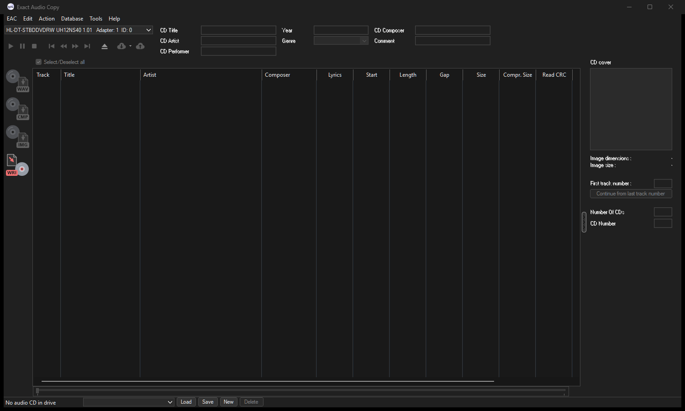
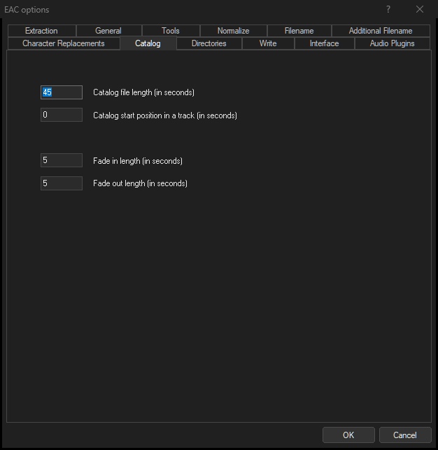
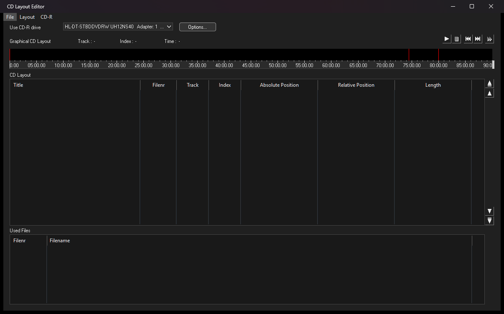

# EAC Dark Mode (unofficial)

Dark mode for [Exact Audio Copy](https://www.exactaudiocopy.de/) 1.8 on Windows 10/11.
It is a drop-in `msacm32.dll` that you put next to `EAC.exe`; EAC itself is not modified.

> Not affiliated with or endorsed by the author of Exact Audio Copy. This is a test build:
> please report anything that still looks light, unreadable or broken.



| | |
|---|---|
|  |  |

## Install
1. Download `msacm32.dll` from the [latest release](../../releases).
2. Close EAC.
3. Copy `msacm32.dll` into the EAC folder (normally `C:\Program Files (x86)\Exact Audio Copy`).
4. Start EAC.

Switch with **Tools > Light Mode** / **Tools > Dark Mode**; it changes live and is remembered in
`eacdark.ini` next to `EAC.exe`.

**Uninstall:** close EAC and delete `msacm32.dll` (and `eacdark.ini`) from the EAC folder.

The DLL forwards all 44 msacm32 functions to the real `SysWOW64\msacm32.dll`, so audio codecs keep working.

## What is covered
- Main window, menus, track list (with light track icons), status bar, cover panel, position slider, tooltips.
- Extracting Audio Data (copy and test): progress bars, Status list, Cancel/Skip buttons, the cancel warning.
- All option dialogs (EAC, drive, compression, metadata), tabs, check boxes, radio buttons, group boxes,
  edit fields, combo boxes and push buttons, with dark grey borders instead of white ones.
- The main window's buttons get flat icons in dark mode (light mode keeps EAC's own icons).
- CD Layout Editor: buttons, time ruler and the graphical track layout.
- Metadata plugin windows (CUETools DB, MusicBrainz, GD3), which are .NET WinForms.
- The Windows file and folder dialogs follow your Windows theme and are left alone.

Not yet checked: writing a CD.

### Crash fix: Load CUE Sheet with WinFsp installed
With [WinFsp](https://winfsp.dev/) installed, EAC (and other 32-bit programs) crashed when opening a file
dialog, for example CD Layout Editor > Load CUE Sheet. WinFsp registers only its 64-bit DLL as a network
provider. This DLL makes EAC load WinFsp's 32-bit DLL from the same folder instead. The fix is active
even when dark mode is switched off.

## Reporting problems
Set `Debug=1` in `eacdark.ini`, reproduce the problem, then attach `eacdark.log` (next to `EAC.exe`) and a
screenshot to an issue.

```
[EacDark]
Enabled=1   ; dark mode on/off (the Tools menu writes this)
Debug=0     ; 1 = write eacdark.log next to EAC.exe
```

## Building
Needs Visual Studio 2022 or newer with the C++ desktop tools. Run `build.bat`; it writes `build\msacm32.dll`.
`install.ps1` closes EAC and copies the DLL into the EAC folder (`-Uninstall` removes it).

| | |
|---|---|
| `src/eacdark.cpp` | the dark-mode engine: CBT hook and subclassing, custom painting, GetSysColor/FillRect hooks |
| `src/icons.cpp` | flat vector icons for the main window's buttons (GDI+) |
| `src/proxy.cpp`, `src/msacm32.def` | msacm32 forwarding stubs |
| `tools/` | test helpers: window tree, screenshots, sending menu commands |

## How it works
- A per-thread CBT hook subclasses EAC's windows as they are created. Controls get the Windows dark
  visual styles, and the parts that have none (check boxes, group boxes, tabs, status bar, menu bar,
  push buttons) are painted by the DLL.
- `GetSysColor`/`GetSysColorBrush` are hooked (import tables and a hot-patch in user32), so EAC's own
  drawing, comctl32 and .NET `SystemColors` follow the dark palette.
- EAC paints its image buttons with GDI+ on its own DC; the DLL reads the pixels back and recolours them
  (or draws its own icons on the main window).
- WinForms plugin windows are subclassed once they are shown, because WinForms replaces the window
  procedure after creation.

## License
MIT
